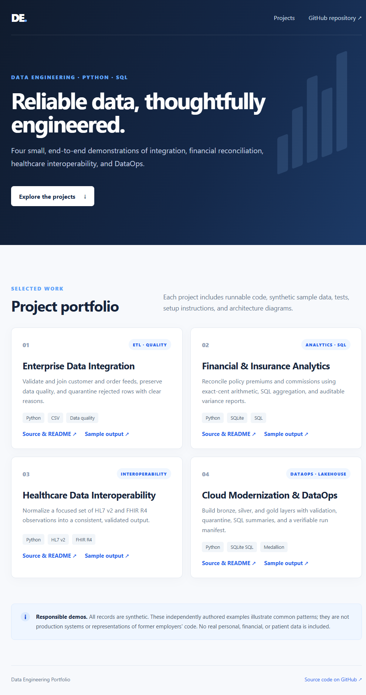

# Data Engineering Portfolio

Four runnable portfolio demonstrations covering data integration, financial reconciliation, healthcare interoperability, and local lakehouse/DataOps patterns.

> **Scope and data:** These are independently authored demonstrations based on broad project themes from a resume, not source code from previous employers or claims about their production systems. All included records are synthetic. Do not use these examples with real financial, insurance, or patient data.

## Projects

| Project | Demonstrates | Run locally |
|---|---|---|
| [01 — Enterprise Data Integration](projects/01-enterprise-data-integration/README.md) | Validated CSV ingestion, customer/order integration, and rejected-record quarantine | `python projects/01-enterprise-data-integration/src/etl.py` |
| [02 — Financial & Insurance Analytics](projects/02-financial-insurance-analytics/README.md) | SQLite warehouse, exact-cent reconciliation, and variance reporting | `python projects/02-financial-insurance-analytics/src/reconcile.py` |
| [03 — Healthcare Interoperability](projects/03-healthcare-interoperability/README.md) | Synthetic HL7 v2 ORU and FHIR R4 observation normalization | `python projects/03-healthcare-interoperability/src/interop.py` |
| [04 — Cloud Modernization & DataOps](projects/04-cloud-dataops/README.md) | Bronze/silver/gold processing, validation, quarantine, and run manifest | `python projects/04-cloud-dataops/src/medallion.py` |

All four projects run on Python 3.11+ and the standard library; no cloud account or third-party package is needed for the local demos.

## Quick start

```powershell
python --version
python projects/01-enterprise-data-integration/src/etl.py
python projects/02-financial-insurance-analytics/src/reconcile.py
python projects/03-healthcare-interoperability/src/interop.py
python projects/04-cloud-dataops/src/medallion.py
python -m unittest discover -s projects -p "test_*.py" -v
```

Generated files go to each project's ignored `output/` directory, except the DataOps demo, which writes to `projects/04-cloud-dataops/output/lakehouse/`.

## Architecture

The [live portfolio landing page](https://atifwright57.github.io/fatima-projects/) is published from `docs/` with GitHub Pages. The [portfolio architecture and data-flow diagrams](docs/portfolio-architecture.md) describe the shared design boundaries. Each project README has setup instructions, a Mermaid architecture/data-flow graph, a conceptual class diagram, a sample-output screenshot, a hosted synthetic preview, test commands, and a data disclaimer.



## Tests and demos

- Run all unit tests locally with `python -m unittest discover -s projects -p "test_*.py" -v`.
- Run each project with the commands in the table above. The pipelines write sample reports locally; generated outputs are intentionally excluded from Git.
- GitHub Pages hosts a static portfolio page, not a live backend. Cloud infrastructure is not provisioned automatically.

## Limitations

These are small, local demonstrations—not production integrations, certified healthcare software, or cloud deployments. The healthcare example implements a deliberately narrow HL7/FHIR subset; the DataOps example emulates medallion storage on the local filesystem. Real deployment requires environment-specific security, privacy, infrastructure, operational controls, and credentials.
