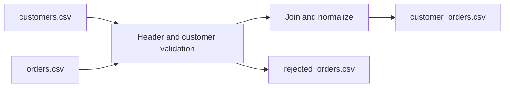
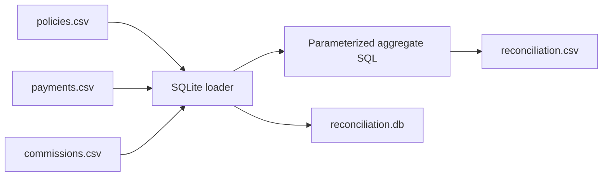
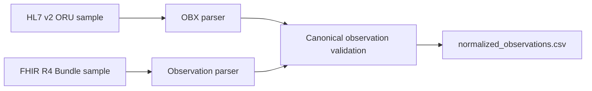
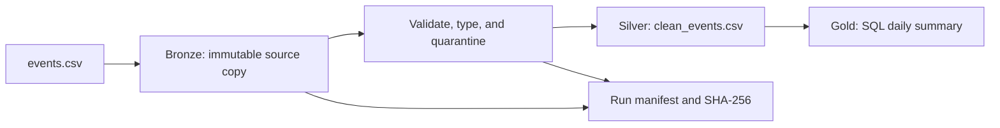
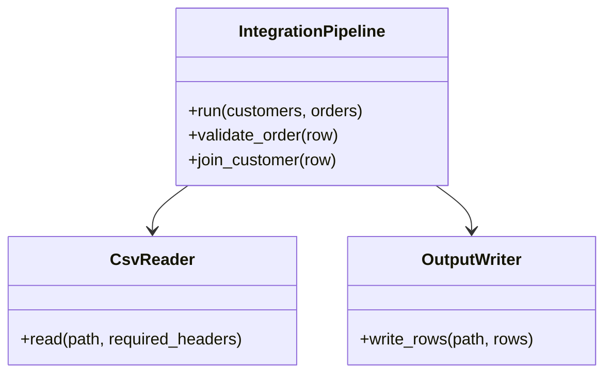
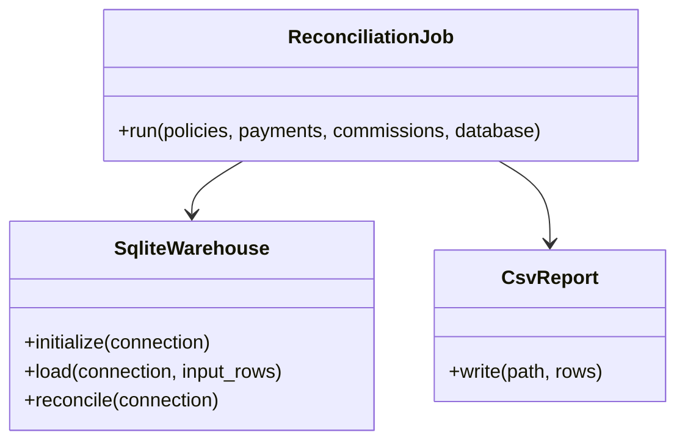
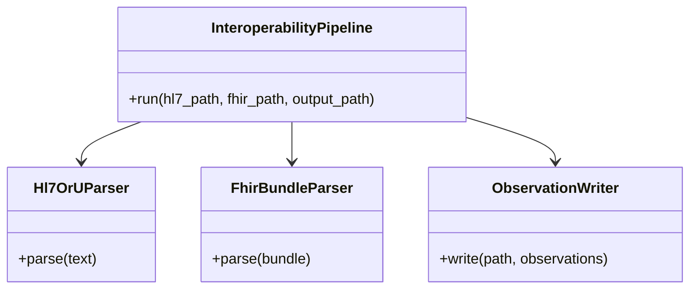
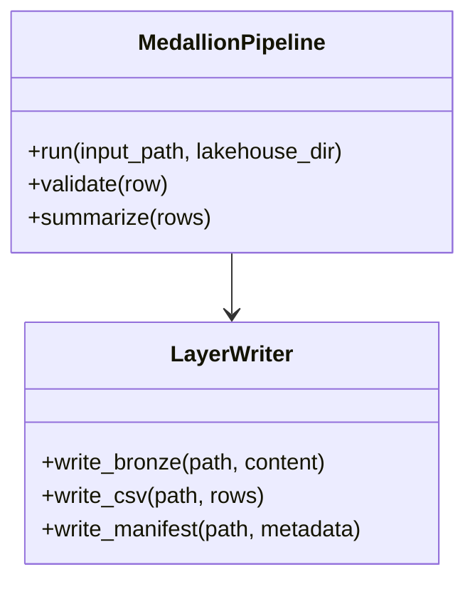

# Portfolio architecture and data flows

Every project is an isolated, dependency-free Python demonstration. Inputs are synthetic files checked into that project's `data/` directory. Generated databases, reports, manifests, and lakehouse layers are ignored by Git.

## 01 — Enterprise data integration

## 02 — Financial and insurance analytics

## 03 — Healthcare interoperability

## 04 — Cloud modernization and DataOps

## Class diagrams

### Enterprise integration

### Financial reconciliation

### Healthcare interoperability

### DataOps

