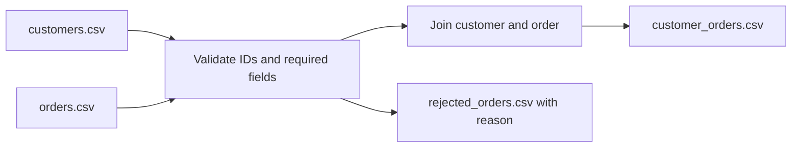
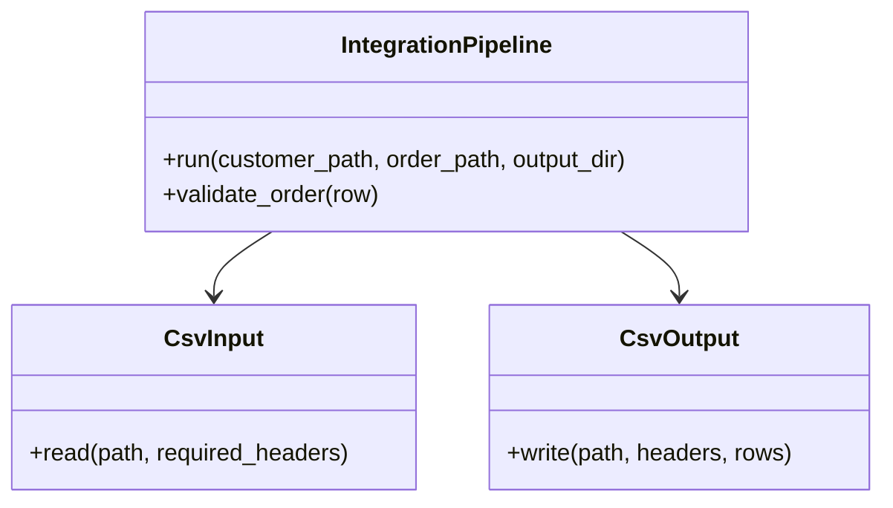

# 01 — Enterprise Data Integration Platform

An executable Python ETL demonstration that validates customer and order CSVs, joins valid orders to customers, and quarantines invalid or unmatched records with a reason.

## Run

From the repository root, with Python 3.11 or later:

```powershell
python projects/01-enterprise-data-integration/src/etl.py
```

The demo writes `customer_orders.csv` and `rejected_orders.csv` beneath this project's ignored `output/` directory. Rejected rows are reported rather than silently discarded.

## Data flow



## Class diagram



## Data contract and testing

Inputs are synthetic and use only fictitious IDs, names, email domains, dates, and amounts. Order IDs must be unique; amounts must be positive decimals; dates must be ISO `YYYY-MM-DD`; each order must reference a known customer. Tests cover valid joins, duplicate IDs, bad dates/amounts, and missing customers:

Run all portfolio tests from the repository root with `python -m unittest discover -s projects -p "test_*.py" -v`.

## Limitations

This local CSV example has no external connectors, distributed execution, secrets, or production-scale scheduling. Its schema and validation rules are demonstration choices, not employer-specific specifications.
