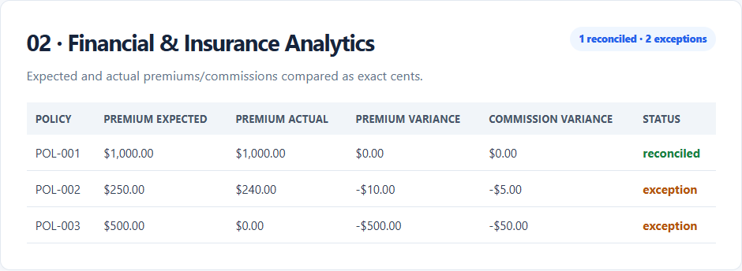
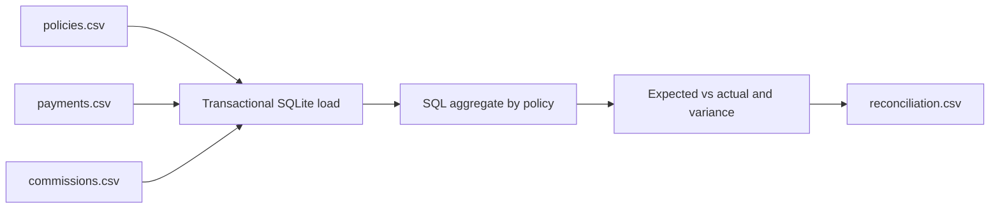
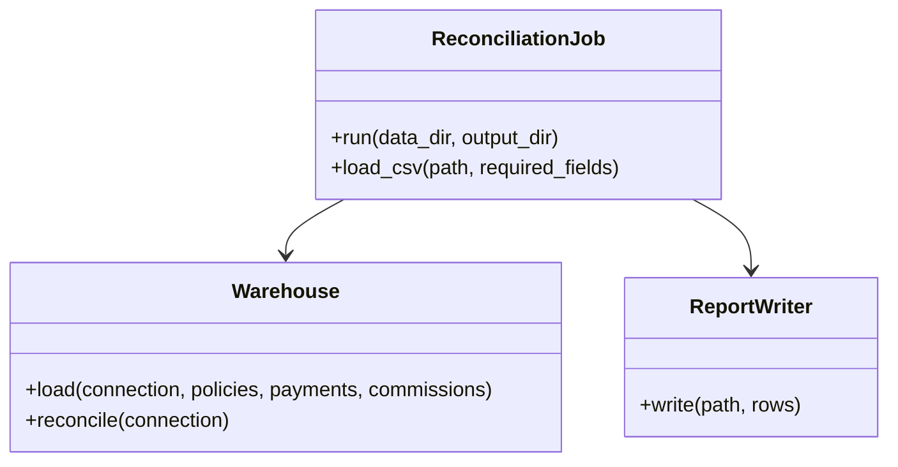

# 02 — Financial & Insurance Analytics Platform

A local SQLite analytics demo that loads synthetic policies, payments, and commissions; reconciles exact integer cents with SQL; and writes a variance report.

## Run

```powershell
python projects/02-financial-insurance-analytics/src/reconcile.py
```

Outputs are `reconciliation.db` and `reconciliation.csv` in this project's ignored `output/` directory. The schema and aggregate query are readable in `sql/schema.sql` and `sql/reconciliation.sql`.

## Sample result

[View the live synthetic output preview](https://fatimablake57.github.io/fatima-projects/demos/#project-02).



## Data flow



## Conceptual class diagram

The runnable code uses module-level functions; this UML-style view describes the logical responsibilities, not classes implemented in the demo.



## Testing

```powershell
python -m unittest discover -s projects -p "test_*.py" -v
```

Tests check exact-cent aggregation, matched policies, missing payment/commission variances, and repeatable loads. Values are synthetic; use of integer cents avoids binary floating-point rounding in the reconciliation.

## Limitations

The schema, matching rules, and sample calculations are illustrative. This is not a payment processor, accounting system, fraud detector, or regulated financial product.
