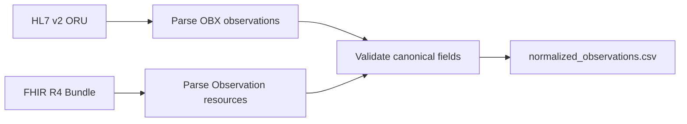
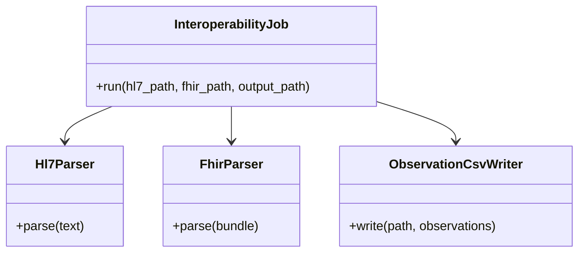

# 03 — Healthcare Data Interoperability Platform

A small, local interoperability demo that parses a deliberately narrow subset of HL7 v2 ORU messages and FHIR R4 Bundles into one validated observation CSV.

## Run

```powershell
python projects/03-healthcare-interoperability/src/interop.py
```

The output is `normalized_observations.csv` in this project's ignored `output/` directory. Both checked-in inputs are synthetic and contain no real patient information.

## Data flow



## Class diagram



## Testing

```powershell
python -m unittest discover -s projects -p "test_*.py" -v
```

Tests cover HL7 OBX extraction, FHIR Bundle extraction, normalized output, and invalid input handling.

## Safety and limitations

This is not a certified clinical system, a complete HL7/FHIR implementation, or a substitute for clinical validation. It handles only the sample message structure and a basic FHIR Bundle with Observation resources. Do not supply real PHI; production use would require formal security, privacy, consent, terminology, and interoperability review.
