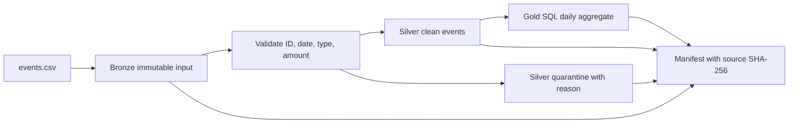
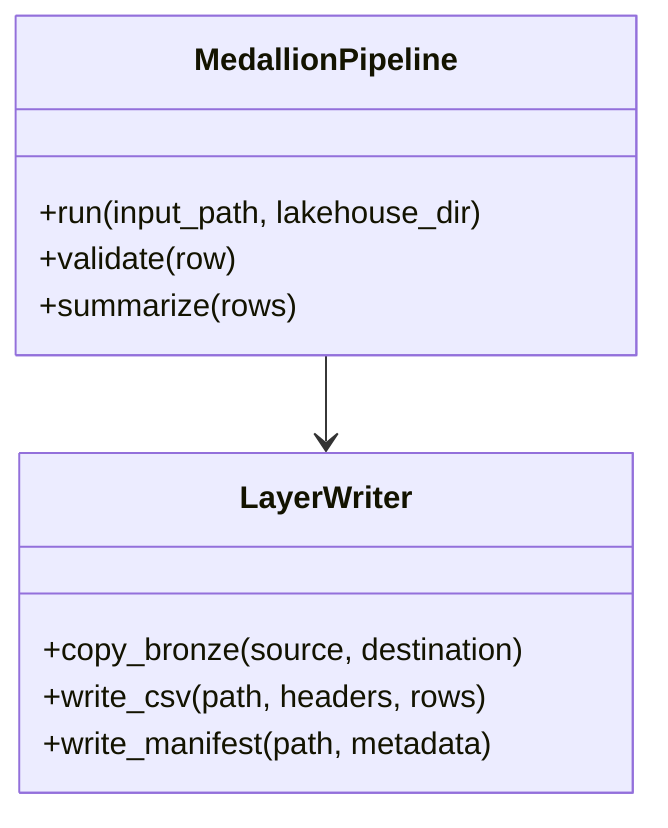

# 04 — Cloud Data Modernization & DataOps Framework

A runnable local medallion-pipeline demo: preserve a bronze copy of a synthetic event feed, validate and quarantine rows into silver, compute a daily gold summary with SQLite SQL, and write a run manifest with an input SHA-256.

## Run

```powershell
python projects/04-cloud-dataops/src/medallion.py
```

The default lakehouse is written beneath `projects/04-cloud-dataops/output/lakehouse/`:

- `bronze/events.csv` — byte-for-byte source copy
- `silver/clean_events.csv` — accepted and typed events
- `silver/quarantined_events.csv` — rejected rows and reasons
- `gold/daily_summary.csv` — event count and amount by event date
- `manifest.json` — source hash, record counts, and run status

## Data flow



## Class diagram



## Testing

```powershell
python -m unittest discover -s projects -p "test_*.py" -v
```

Tests cover accepted/rejected events, deterministic output, daily totals, and the bronze hash.

## Deployment

Run the command above locally to generate and inspect the layer files. The GitHub Pages site is a static portfolio overview; it does not run the pipeline.

The filesystem layout models medallion layers but is not an AWS service deployment. Adapting it to S3, Glue, or another cloud requires an account, least-privilege identity, encryption and retention policies, environment-specific configuration, and a reviewed infrastructure plan. No infrastructure is created automatically.
